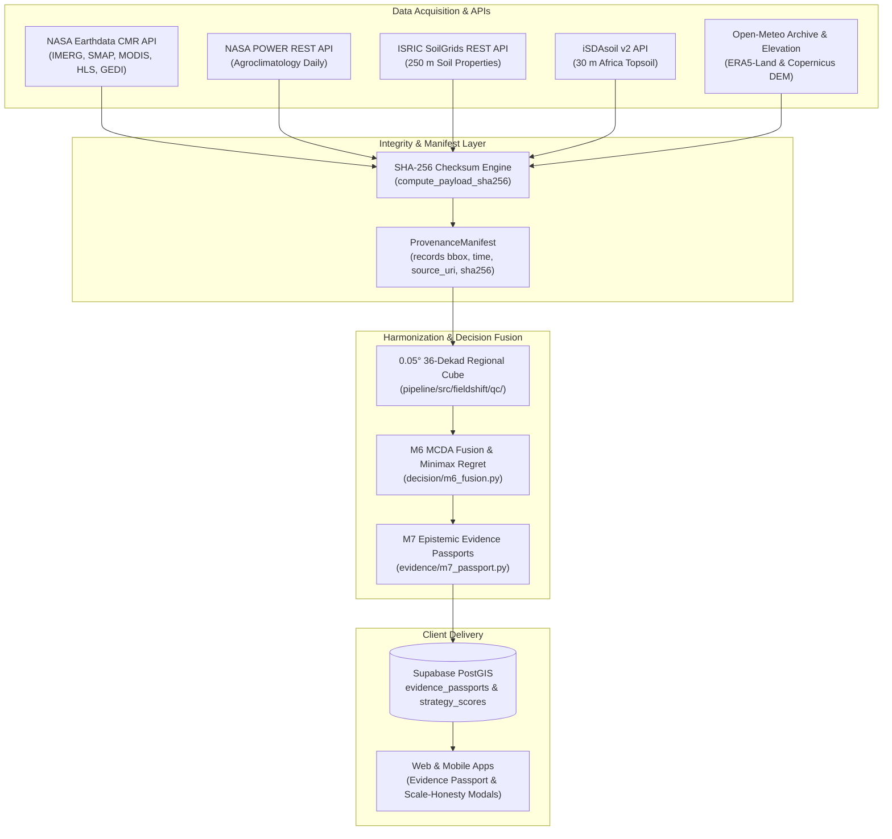

# Field Shift — Comprehensive Dataset Registry & Documentation

This document catalogs every Earth observation, atmospheric reanalysis, gridded soil, digital elevation, and agronomic dataset used in **Field Shift** (`pipeline/src/fieldshift/`, `apps/api/`, `apps/web/`, and `apps/mobile/`).

Every dataset listed below is integrated into our live or synthetic ingestion pipeline, verified with SHA-256 checksum provenance tracking (`pipeline/src/fieldshift/ingest/manifest.py`), mapped onto our 0.05° (~5.5 km) Ashanti regional grid across 36 annual dekads, and bound to deterministic Evidence Passports (`M7`) in Supabase.

---

## 1. Master Dataset Registry & Quick Links

| Product ID / Key | Dataset Name | Agency / Provider / DAAC | Spatial Resolution | Temporal Cadence | Primary Agricultural Role | Official Links |
| :--- | :--- | :--- | :--- | :--- | :--- | :--- |
| **`GPM_3IMERGDF`** (V07) | GPM IMERG Final Precipitation L3 | NASA GES DISC | 0.1° (~10 km) | Daily | Calibrated rainfall amounts, onset/cessation, dry spells | [GES DISC](https://disc.gsfc.nasa.gov/datasets/GPM_3IMERGDF_07/summary) · [Earthdata Search](https://search.earthdata.nasa.gov/search?q=GPM_3IMERGDF) · [DOI](https://doi.org/10.5067/GPM/IMERGDF/DAY/07) |
| **`SPL3SMP_E`** (006) | SMAP L3 Enhanced Surface Soil Moisture | NASA NSIDC DAAC | 9 km (EASE-Grid 2.0) | Daily / 2–3 day revisit | Top 0–5 cm volumetric soil moisture & dry-down rates | [NSIDC](https://nsidc.org/data/spl3smp_e/versions/6) · [Earthdata Search](https://search.earthdata.nasa.gov/search?q=SPL3SMP_E) · [DOI](https://doi.org/10.5067/4DQASW1B5Y3A) |
| **`SPL4SMGP`** (008) | SMAP L4 Global Surface & Root-Zone Moisture | NASA NSIDC DAAC / GMAO | 9 km (EASE-Grid 2.0) | 3-hourly / Daily | 0–100 cm root-zone soil water assimilation | [NSIDC](https://nsidc.org/data/spl4smgp/versions/8) · [Earthdata Search](https://search.earthdata.nasa.gov/search?q=SPL4SMGP) · [DOI](https://doi.org/10.5067/S8QW2798T057) |
| **`HLSL30` / `HLSS30`** (2.0) | Harmonized Landsat & Sentinel-2 (HLS) | NASA LP DAAC / USGS / ESA | 30 m | 2–5 days combined | Field-scale NDVI/EVI greenness, bare-soil detection, Fmask cloud QA | [LP DAAC](https://lpdaac.usgs.gov/products/hlsl30v002/) · [Planetary Computer](https://planetarycomputer.microsoft.com/dataset/hls) · [Earthdata](https://search.earthdata.nasa.gov/search?q=HLSL30) |
| **`MOD13Q1`** (061) | MODIS Terra Vegetation Indices 16-Day | NASA LP DAAC | 250 m | 16-day composite | 20-year historical baseline phenology & seasonal green-up | [LP DAAC](https://lpdaac.usgs.gov/products/mod13q1v061/) · [Earthdata Search](https://search.earthdata.nasa.gov/search?q=MOD13Q1) · [DOI](https://doi.org/10.5067/MODIS/MOD13Q1.061) |
| **`MOD11A2`** (061) | MODIS Land Surface Temperature & Emissivity | NASA LP DAAC | 1 km | 8-day composite | Daytime/Nighttime thermal stress, heat accumulation | [LP DAAC](https://lpdaac.usgs.gov/products/mod11a2v061/) · [Earthdata Search](https://search.earthdata.nasa.gov/search?q=MOD11A2) · [DOI](https://doi.org/10.5067/MODIS/MOD11A2.061) |
| **`GEDI02_B`** (002) | GEDI Canopy Cover & Vertical Profile Metrics | NASA LP DAAC / UMD | 25 m footprints | Irregular orbital tracks | Agroforestry canopy cover, tree-shade fraction, PAI | [LP DAAC](https://lpdaac.usgs.gov/products/gedi02_bv002/) · [Earthdata Search](https://search.earthdata.nasa.gov/search?q=GEDI02_B) · [DOI](https://doi.org/10.5067/GEDI/GEDI02_B.002) |
| **`SRTMGL1`** (003) | SRTM 1 Arc-Second Global Elevation | NASA LP DAAC / USGS | 1 arc-second (~30 m) | Static | Topographic elevation, catchment slope, runoff risk | [LP DAAC](https://lpdaac.usgs.gov/products/srtmgl1v003/) · [Earthdata Search](https://search.earthdata.nasa.gov/search?q=SRTMGL1) · [DOI](https://doi.org/10.5067/MEaSUREs/SRTM/SRTMGL1.003) |
| **`ECO2LSTE`** (002) | ECOSTRESS Land Surface Temperature | NASA LP DAAC / JPL | 70 m | Irregular diurnal | Evapotranspiration stress hotspots & diurnal canopy heat | [LP DAAC](https://lpdaac.usgs.gov/products/eco2lstev002/) · [Earthdata Search](https://search.earthdata.nasa.gov/search?q=ECO2LSTE) · [DOI](https://doi.org/10.5067/ECOSTRESS/ECO2LSTE.002) |
| **`POWER_DAILY_AGRO`** (v9) | NASA POWER Agroclimatology Daily Point API | NASA Langley (LaRC) | 0.5° (~50 km) | Daily | Solar radiation (`ALLSKY_SFC_SW_DWN`), T2M, RH2M, surface wetness | [NASA POWER Portal](https://power.larc.nasa.gov/) · [API Endpoint](https://power.larc.nasa.gov/api/temporal/daily/point) · [Documentation](https://power.larc.nasa.gov/docs/) |
| **`COPERNICUS_DEM_GLO90`** | Copernicus Digital Elevation Model GLO-90 | ESA / Copernicus / Open-Meteo | 90 m | Static | Analysis grid cell altitude & 4-neighbor finite-difference terrain slope | [Copernicus Space Data](https://spacedata.copernicus.eu/collections/copernicus-digital-elevation-model) · [Open-Meteo Elevation API](https://api.open-meteo.com/v1/elevation) |
| **`ECMWF_ERA5_LAND`** (v1) | ECMWF ERA5-Land Atmospheric Reanalysis | Copernicus C3S / ECMWF / Open-Meteo | 0.1° (~9 km) | Daily / Hourly | Reference $ET_0$ (FAO-56), $0\text{--}7\text{ cm}$ soil moisture (`swvl1`), cloud cover | [Copernicus Climate Data Store](https://cds.climate.copernicus.eu/datasets/reanalysis-era5-land) · [Open-Meteo Archive](https://archive-api.open-meteo.com/v1/archive) · [DOI](https://doi.org/10.24381/cds.e2161bac) |
| **`ISRIC_SOILGRIDS_V2`** (2.0) | ISRIC SoilGrids v2.0 Global Soil Property Maps | ISRIC — World Soil Information | 250 m | Static | Global replacement for SSURGO: pH ($pH_{H2O}$), SOC, clay, sand, silt | [ISRIC SoilGrids](https://www.isric.org/explore/soilgrids) · [REST API](https://rest.isric.org/soilgrids/v2.0/properties/query) · [DOI](https://doi.org/10.5194/soil-7-217-2021) |
| **`ISDASOIL_V2_30M`** (2.0) | iSDAsoil v2 African Soil Information System | iSDA Africa (CC BY 4.0) | 30 m | Static (0–20 cm) | Sub-Saharan Africa 30 m topsoil pH, texture, Al toxicity, nutrients | [iSDAsoil Portal](https://www.isda-africa.com/isdasoil/) · [API Documentation](https://www.isda-africa.com/isdasoil/faq/) |
| **Local Agronomic Priors** | Ashanti Crop Knowledge & Rotation Systems | CSIR-CRI, CSIR-SARI, MoFA SRID, COCOBOD, FAO | Farm / Plot scale | Curated CSVs | Water requirements ($P/ET_0$), biological N-fixation, cycle length, heat limits | [CSIR-CRI Kumasi](https://cropsresearch.org/) · [MoFA Ghana](https://mofa.gov.gh/) · [FAO EcoCrop](https://ecocrop.fao.org/) · [knowledge/](file:///Users/kaliblip/Developer/Field_Shift/knowledge/) |

---

## 2. Detailed Dataset Profiles

### 2.1 NASA GPM IMERG Final Precipitation (`GPM_3IMERGDF` V07)
- **Data Provider:** NASA Goddard Earth Sciences Data and Information Services Center (GES DISC).
- **Mission:** Global Precipitation Measurement (GPM) Core Observatory & International Constellation.
- **Short Name & Version:** `GPM_3IMERGDF` Version 07.
- **Spatial Resolution:** $0.1^\circ \times 0.1^\circ$ (~10 km at the equator).
- **Temporal Cadence:** Daily (composite of half-hourly multi-satellite microwave and geo-infrared retrievals calibrated with monthly GPCC rain gauge analyses).
- **Access Endpoints & Direct Links:**
  - Product Summary & Download: [https://disc.gsfc.nasa.gov/datasets/GPM_3IMERGDF_07/summary](https://disc.gsfc.nasa.gov/datasets/GPM_3IMERGDF_07/summary)
  - NASA Earthdata Search: [https://search.earthdata.nasa.gov/search?q=GPM_3IMERGDF](https://search.earthdata.nasa.gov/search?q=GPM_3IMERGDF)
  - DOI: [https://doi.org/10.5067/GPM/IMERGDF/DAY/07](https://doi.org/10.5067/GPM/IMERGDF/DAY/07)
  - Ingestion Adapter: Ingested via `earthaccess.search_data(short_name="GPM_3IMERGDF", version="07")` and direct NetCDF4 subsetting in `pipeline/src/fieldshift/ingest/sources.py`.
- **Variables Used in Field Shift:** `precipitation` ($mm/\text{day}$).
- **Agricultural Role:**
  - Establishes the 36-dekad seasonal rainfall distribution for each analysis cell.
  - Determines the start and cessation of the Major Rainy Season (dekads 7–21, March to July) and Minor Rainy Season (dekads 25–33, September to November).
  - Computes dry-spell frequency, consecutive rainless days, and 5-year precipitation anomaly trends (`M1`, `M4`).
- **Scale-Honesty & Limitations:**
  - Coarse ~10 km footprint aggregates multiple convective cloud cells; smallholder fields (0.5–2 ha) experience localized convective showers that may diverge from the regional mean. Validated against ERA5-Land reanalysis in `pipeline/src/fieldshift/models/validation.py`.

---

### 2.2 NASA SMAP L3 Enhanced Surface Soil Moisture (`SPL3SMP_E` V006)
- **Data Provider:** NASA National Snow and Ice Data Center (NSIDC) Distributed Active Archive Center (DAAC).
- **Mission:** Soil Moisture Active Passive (SMAP).
- **Short Name & Version:** `SPL3SMP_E` Version 006 (Backus-Gilbert enhanced radiometer retrieval).
- **Spatial Resolution:** 9 km posted on the global cylindrical Equal-Area Scalable Earth Grid (EASE-Grid 2.0).
- **Temporal Cadence:** Daily composite (2–3 day equatorial revisit period, ascending 6:00 PM and descending 6:00 AM orbits).
- **Access Endpoints & Direct Links:**
  - Product Page: [https://nsidc.org/data/spl3smp_e/versions/6](https://nsidc.org/data/spl3smp_e/versions/6)
  - NASA Earthdata Search: [https://search.earthdata.nasa.gov/search?q=SPL3SMP_E](https://search.earthdata.nasa.gov/search?q=SPL3SMP_E)
  - DOI: [https://doi.org/10.5067/4DQASW1B5Y3A](https://doi.org/10.5067/4DQASW1B5Y3A)
- **Variables Used in Field Shift:** `soil_moisture` ($cm^3/cm^3$ volumetric soil water content for top $0\text{--}5\text{ cm}$), `retrieval_qual_flag`.
- **Agricultural Role:**
  - Captures topsoil moisture dry-down dynamics immediately following planting rainfall.
  - Evaluates early crop emergence conditions and soil crusting risks in the forest-transition corridor.
- **Scale-Honesty & Limitations:**
  - Measures strictly the top 5 cm of the soil profile. 9 km pixels provide regional context and cannot detect drainage differences between furrow and crest within a 1 ha farm.

---

### 2.3 NASA SMAP L4 Global Surface and Root-Zone Soil Moisture (`SPL4SMGP` V008)
- **Data Provider:** NASA NSIDC DAAC / NASA Global Modeling and Assimilation Office (GMAO).
- **Short Name & Version:** `SPL4SMGP` Version 008.
- **Spatial Resolution:** 9 km global EASE-Grid 2.0.
- **Temporal Cadence:** 3-hourly geophysical analysis composites (daily aggregates ingested).
- **Access Endpoints & Direct Links:**
  - Product Page: [https://nsidc.org/data/spl4smgp/versions/8](https://nsidc.org/data/spl4smgp/versions/8)
  - NASA Earthdata Search: [https://search.earthdata.nasa.gov/search?q=SPL4SMGP](https://search.earthdata.nasa.gov/search?q=SPL4SMGP)
  - DOI: [https://doi.org/10.5067/S8QW2798T057](https://doi.org/10.5067/S8QW2798T057)
- **Variables Used in Field Shift:** `sm_surface` ($0\text{--}5\text{ cm}$), `sm_rootzone` ($0\text{--}100\text{ cm}$ volumetric soil water content, $m^3/m^3$).
- **Agricultural Role:**
  - Evaluates water availability at deep rooting depths for long-season staples (cassava, yam) and agroforestry trees (cocoa).
  - Used in the **Flash-Drought Decoupling Detector** (`detect_flash_drought_dekads` in `seasonal.py`) to detect situations where surface moisture drops rapidly while root-zone moisture remains buffered.
- **Scale-Honesty & Limitations:**
  - Model-assimilated product integrating satellite radiometer data with Catchment Land Surface Model simulations driven by GEOS-5 weather inputs.

---

### 2.4 NASA Harmonized Landsat and Sentinel-2 (`HLSL30` & `HLSS30` v2.0)
- **Data Provider:** NASA Land Processes DAAC (LP DAAC) / USGS / ESA / Microsoft Planetary Computer STAC.
- **Satellites:** Landsat 8/9 Operational Land Imager (OLI) and Copernicus Sentinel-2A/2B MultiSpectral Instrument (MSI).
- **Short Name & Version:** `HLSL30` (Landsat-30m) & `HLSS30` (Sentinel-30m) Version 2.0.
- **Spatial Resolution:** 30 m grid aligned to the UTM Military Grid Reference System (MGRS).
- **Temporal Cadence:** 2 to 5 day observation frequency when combining both constellations.
- **Access Endpoints & Direct Links:**
  - USGS LP DAAC Product Landing Page: [https://lpdaac.usgs.gov/products/hlsl30v002/](https://lpdaac.usgs.gov/products/hlsl30v002/)
  - Microsoft Planetary Computer HLS Catalog: [https://planetarycomputer.microsoft.com/dataset/hls](https://planetarycomputer.microsoft.com/dataset/hls)
  - NASA Earthdata Search: [https://search.earthdata.nasa.gov/search?q=HLSL30](https://search.earthdata.nasa.gov/search?q=HLSL30)
  - DOI: [https://doi.org/10.5067/HLS/HLSL30.002](https://doi.org/10.5067/HLS/HLSL30.002)
  - STAC API Endpoint: `https://planetarycomputer.microsoft.com/api/stac/v1/search`
- **Variables Used in Field Shift:**
  - Surface Reflectance: Band 4 (Red, $\approx 640\text{--}670\text{ nm}$), Band 5/8A (Near-Infrared, $\approx 850\text{--}880\text{ nm}$), Band 6 (SWIR-1).
  - Quality Assessment: `Fmask` (Cloud, cloud shadow, adjacent cloud, and water mask bits).
  - Derived Indices: Normalized Difference Vegetation Index ($\text{NDVI} = \frac{\text{NIR} - \text{Red}}{\text{NIR} + \text{Red}}$).
- **Agricultural Role:**
  - Provides the primary **30 m parcel-scale canopy cover & bare-ground detection** (`M3`).
  - Identifies Harmattan bare-soil exposure windows (December–February) when fields are vulnerable to wind and early convective storms.
- **Scale-Honesty & Limitations:**
  - 30 m resolution closely matches typical smallholder parcel boundaries in Ashanti ($0.5\text{--}2\text{ ha} = 5,000\text{--}20,000\text{ m}^2$, spanning ~5 to 22 pixels). Heavy equatorial cloud cover during peak June rains requires pixel-level QA masking and multi-sensor temporal compositing.

---

### 2.5 NASA MODIS Vegetation Indices 16-Day (`MOD13Q1` V061)
- **Data Provider:** NASA LP DAAC.
- **Sensor:** Moderate Resolution Imaging Spectroradiometer (MODIS) on Terra.
- **Short Name & Version:** `MOD13Q1` Version 061.
- **Spatial Resolution:** 250 m sinusoidal grid.
- **Temporal Cadence:** 16-day composite.
- **Access Endpoints & Direct Links:**
  - Product Page: [https://lpdaac.usgs.gov/products/mod13q1v061/](https://lpdaac.usgs.gov/products/mod13q1v061/)
  - NASA Earthdata Search: [https://search.earthdata.nasa.gov/search?q=MOD13Q1](https://search.earthdata.nasa.gov/search?q=MOD13Q1)
  - DOI: [https://doi.org/10.5067/MODIS/MOD13Q1.061](https://doi.org/10.5067/MODIS/MOD13Q1.061)
- **Variables Used in Field Shift:** `250m_16_days_NDVI`, `250m_16_days_EVI`, `250m_16_days_pixel_reliability`.
- **Agricultural Role:**
  - Provides unbroken historical decadal baseline curves (2000–present) across the Ashanti pilot corridor.
  - Used in `models/phenology.py` (`M3`) to calibrate long-term seasonal green-up envelopes and historical minimum vegetative cover levels.
- **Scale-Honesty & Limitations:**
  - 250 m pixels ($6.25\text{ ha}$) inevitably blend adjacent farm boundaries, bush fallows, and tree lines. Used for district-scale phenology baselines, not parcel-boundary claims.

---

### 2.6 NASA MODIS Land Surface Temperature 8-Day (`MOD11A2` V061)
- **Data Provider:** NASA LP DAAC.
- **Sensor:** MODIS on Terra.
- **Short Name & Version:** `MOD11A2` Version 061 (Planetary Computer Cloud-Optimized GeoTIFFs).
- **Spatial Resolution:** 1 km sinusoidal grid.
- **Temporal Cadence:** 8-day composite (daytime and nighttime overpasses).
- **Access Endpoints & Direct Links:**
  - Product Page: [https://lpdaac.usgs.gov/products/mod11a2v061/](https://lpdaac.usgs.gov/products/mod11a2v061/)
  - NASA Earthdata Search: [https://search.earthdata.nasa.gov/search?q=MOD11A2](https://search.earthdata.nasa.gov/search?q=MOD11A2)
  - DOI: [https://doi.org/10.5067/MODIS/MOD11A2.061](https://doi.org/10.5067/MODIS/MOD11A2.061)
- **Variables Used in Field Shift:** `LST_Day_1km` ($K \rightarrow ^\circ\text{C}$), `QC_Day`.
- **Agricultural Role:**
  - Flags heat-stress anomalies exceeding physiological thresholds for staple crops (e.g., $T_{\text{max}} > 34^\circ\text{C}$ for maize flowering; $T_{\text{max}} > 36^\circ\text{C}$ for cassava canopy scorch).
  - Supplies temperature inputs for thermal stress index calculations in `pipeline/src/fieldshift/models/anomaly.py` (`M1`).
- **Scale-Honesty & Limitations:**
  - 1 km spatial resolution; daytime thermal readings under heavy equatorial cloud are masked via `QC_Day` flags.

---

### 2.7 NASA GEDI Canopy Cover and Profile Metrics (`GEDI02_B` V002)
- **Data Provider:** NASA LP DAAC / University of Maryland.
- **Mission:** Global Ecosystem Dynamics Investigation (GEDI) LiDAR aboard the International Space Station (ISS).
- **Short Name & Version:** `GEDI02_B` Version 002.
- **Spatial Resolution:** 25 m circular footprints along orbit transects.
- **Temporal Cadence:** Irregular repeat (non-repeating ISS orbital tracks within $51.6^\circ\text{ N/S}$).
- **Access Endpoints & Direct Links:**
  - Product Page: [https://lpdaac.usgs.gov/products/gedi02_bv002/](https://lpdaac.usgs.gov/products/gedi02_bv002/)
  - NASA Earthdata Search: [https://search.earthdata.nasa.gov/search?q=GEDI02_B](https://search.earthdata.nasa.gov/search?q=GEDI02_B)
  - DOI: [https://doi.org/10.5067/GEDI/GEDI02_B.002](https://doi.org/10.5067/GEDI/GEDI02_B.002)
- **Variables Used in Field Shift:** `cover` (canopy cover fraction $0.0\text{--}1.0$), `pai` (Plant Area Index), `fhd_normal` (Foliage Height Diversity).
- **Agricultural Role:**
  - Differentiates open-field annual arable cropland from shade-canopy agroforestry systems (e.g., cocoa farms with *Terminalia ivorensis* or *Milicia excelsa* shade trees).
  - Supplies agroforestry baseline context in `knowledge/crops_ashanti.csv` (`cocoa_perennial_context`).
- **Scale-Honesty & Limitations:**
  - Sparse track sampling (not wall-to-wall); provides statistical canopy structure distributions for grid cells rather than continuous parcel maps.

---

### 2.8 NASA Shuttle Radar Topography Mission Global 1 Arc-Second (`SRTMGL1` V003)
- **Data Provider:** NASA LP DAAC / USGS.
- **Mission:** Shuttle Radar Topography Mission (SRTM aboard Space Shuttle Endeavour STS-99).
- **Short Name & Version:** `SRTMGL1` Version 003.
- **Spatial Resolution:** 1 arc-second (~30 m at the equator).
- **Temporal Cadence:** Static digital elevation model.
- **Access Endpoints & Direct Links:**
  - Product Page: [https://lpdaac.usgs.gov/products/srtmgl1v003/](https://lpdaac.usgs.gov/products/srtmgl1v003/)
  - NASA Earthdata Search: [https://search.earthdata.nasa.gov/search?q=SRTMGL1](https://search.earthdata.nasa.gov/search?q=SRTMGL1)
  - DOI: [https://doi.org/10.5067/MEaSUREs/SRTM/SRTMGL1.003](https://doi.org/10.5067/MEaSUREs/SRTM/SRTMGL1.003)
- **Variables Used in Field Shift:** `elevation` (meters above sea level), derived terrain slope (%).
- **Agricultural Role:**
  - Flags erosion risks on sloping terrain ($> 8\%$) where bare soil during onset storms leads to sheet wash and gullying.
  - Penalizes cassava ridge tillage and tuber mounding without contour mulching on steep slopes.
- **Scale-Honesty & Limitations:**
  - C-band radar reflects from top-of-canopy in dense forests; cross-checked against Copernicus DEM GLO-90.

---

### 2.9 NASA ECOSTRESS Land Surface Temperature & Emissivity (`ECO2LSTE` V002)
- **Data Provider:** NASA LP DAAC / NASA Jet Propulsion Laboratory (JPL).
- **Mission:** ECOsystem Spaceborne Thermal Radiometer Experiment on Space Station (ECOSTRESS).
- **Short Name & Version:** `ECO2LSTE` Version 002.
- **Spatial Resolution:** 70 m.
- **Temporal Cadence:** Diurnal precessing orbit (irregular revisit across morning, noon, and late afternoon).
- **Access Endpoints & Direct Links:**
  - Product Page: [https://lpdaac.usgs.gov/products/eco2lstev002/](https://lpdaac.usgs.gov/products/eco2lstev002/)
  - NASA Earthdata Search: [https://search.earthdata.nasa.gov/search?q=ECO2LSTE](https://search.earthdata.nasa.gov/search?q=ECO2LSTE)
  - DOI: [https://doi.org/10.5067/ECOSTRESS/ECO2LSTE.002](https://doi.org/10.5067/ECOSTRESS/ECO2LSTE.002)
- **Variables Used in Field Shift:** `LST` ($K \rightarrow ^\circ\text{C}$), `QC` flags.
- **Agricultural Role:**
  - Supports microclimatic thermal anomaly inspection during severe dry-spell intervals.
  - Used as auxiliary evidence in Evidence Passports (`M7`) when high-resolution heat stress is suspected.
- **Scale-Honesty & Limitations:**
  - Precessing orbit provides non-uniform revisit intervals; used as episodic verification rather than continuous dekad features.

---

### 2.10 NASA POWER Agroclimatology Daily Point API (`POWER_DAILY_AGRO` v9)
- **Data Provider:** NASA Langley Research Center (LaRC).
- **Project:** Prediction Of Worldwide Energy Resources (POWER) Agroclimatology Methodology.
- **Short Name & Version:** `POWER_DAILY_AGRO` Version 9 (API Release 2.0).
- **Spatial Resolution:** $0.5^\circ \times 0.5^\circ$ (~50 km).
- **Temporal Cadence:** Daily observations (1981–present).
- **Access Endpoints & Direct Links:**
  - Project Portal: [https://power.larc.nasa.gov/](https://power.larc.nasa.gov/)
  - REST API Endpoint: [https://power.larc.nasa.gov/api/temporal/daily/point](https://power.larc.nasa.gov/api/temporal/daily/point)
  - API Documentation: [https://power.larc.nasa.gov/docs/](https://power.larc.nasa.gov/docs/)
  - Query Builder: Ingested programmatically via `fetch_nasa_power_daily(lat, lon, start, end)` in `pipeline/src/fieldshift/ingest/sources.py`.
- **Variables Ingested:**
  - `PRECTOTCORR`: MERRA-2 precipitation corrected with GPCP ($mm/\text{day}$).
  - `T2M`: Temperature at 2 Meters ($^\circ\text{C}$).
  - `T2M_MAX` / `T2M_MIN`: Daily maximum and minimum temperatures ($^\circ\text{C}$).
  - `ALLSKY_SFC_SW_DWN`: All Sky Surface Downward Shortwave Irradiance ($MJ/m^2/\text{day}$).
  - `RH2M`: Relative Humidity at 2 Meters (%).
  - `GWETTOP` / `GWETROOT`: Surface and root-zone soil wetness fractions ($0.0\text{--}1.0$).
  - `CLOUD_AMT`: Daytime cloud cover percentage (%).
- **Agricultural Role:**
  - Computes solar radiation for biomass accumulation and crop growth cycle modeling.
  - Provides long-term 20-year agroclimatic baselines for extreme dry-spell and heat-stress indexing.
- **Scale-Honesty & Limitations:**
  - 50 km cell size reflects regional synoptic climatology. Combined with 9 km ERA5-Land and 30 m HLS for downscaled local decision support.

---

### 2.11 Copernicus DEM Global 90 m (`COPERNICUS_DEM_GLO90`)
- **Data Provider:** European Space Agency (ESA) / Copernicus / Open-Meteo Elevation API.
- **Dataset:** Copernicus Digital Elevation Model GLO-90 (derived from WorldDEM TanDEM-X radar interferometry).
- **Spatial Resolution:** 90 m (3 arc-seconds).
- **Temporal Cadence:** Static surface elevation.
- **Access Endpoints & Direct Links:**
  - Copernicus Space Data Portal: [https://spacedata.copernicus.eu/collections/copernicus-digital-elevation-model](https://spacedata.copernicus.eu/collections/copernicus-digital-elevation-model)
  - Open-Meteo Elevation API: [https://api.open-meteo.com/v1/elevation](https://api.open-meteo.com/v1/elevation)
  - Code Adapter: `fetch_copernicus_dem_topography(cells)` in `pipeline/src/fieldshift/ingest/sources.py`.
- **Variables Used:** `elevation_m` (altitude above sea level), `slope_pct` (4-neighbor finite-difference slope percentage).
- **Agricultural Role:**
  - Calculates cell terrain slope and identifies steep agricultural pockets vulnerable to runoff.

---

### 2.12 ECMWF ERA5-Land Global Atmospheric Reanalysis (`ECMWF_ERA5_LAND` v1)
- **Data Provider:** Copernicus Climate Change Service (C3S) / ECMWF / Open-Meteo Historical Archive.
- **Dataset:** ERA5-Land Reanalysis (ECMWF Integrated Forecasting System CY41R2).
- **Spatial Resolution:** $0.1^\circ \times 0.1^\circ$ (~9 km).
- **Temporal Cadence:** Daily aggregates of hourly reanalysis fields.
- **Access Endpoints & Direct Links:**
  - Copernicus Climate Data Store (CDS): [https://cds.climate.copernicus.eu/datasets/reanalysis-era5-land](https://cds.climate.copernicus.eu/datasets/reanalysis-era5-land)
  - Open-Meteo Historical Weather Archive: [https://archive-api.open-meteo.com/v1/archive](https://archive-api.open-meteo.com/v1/archive)
  - DOI: [https://doi.org/10.24381/cds.e2161bac](https://doi.org/10.24381/cds.e2161bac)
  - Code Adapter: `fetch_era5_land_daily(lat, lon, start, end)` in `pipeline/src/fieldshift/ingest/sources.py`.
- **Variables Ingested:**
  - `rain_era5_mm`: Daily precipitation sum ($mm$).
  - `et0_mm`: Reference evapotranspiration ($ET_0$, FAO-56 Penman-Monteith).
  - `tmax_era5_c` / `tmin_era5_c`: Daily maximum and minimum 2 m temperatures.
  - `cloud_prob_era5`: Mean daily cloud cover fraction ($0.0\text{--}1.0$).
  - `smap_sm_m3m3`: Volumetric soil water in Layer 1 ($0\text{--}7\text{ cm}$, `swvl1`, $m^3/m^3$).
- **Agricultural Role:**
  - Computes the **WaPOR-style Water Satisfaction Index** ($WSI = P / ET_0$).
  - Computes cumulative evaporative deficit ($\max(0, ET_0 - P)$) across each 10-day dekad.
  - Independent precipitation source for the LOYO and cross-source rainfall agreement checks (`models/validation.py`).

---

### 2.13 ISRIC SoilGrids v2.0 Global Soil Property Maps (`ISRIC_SOILGRIDS_V2`)
- **Data Provider:** ISRIC — World Soil Information.
- **Product:** SoilGrids 2020 v2.0 (Machine learning ensemble trained on WoSIS soil profile observations).
- **Spatial Resolution:** 250 m global GeoTIFFs.
- **Temporal Cadence:** Static baseline properties.
- **Access Endpoints & Direct Links:**
  - ISRIC SoilGrids Portal: [https://www.isric.org/explore/soilgrids](https://www.isric.org/explore/soilgrids)
  - REST API Query: [https://rest.isric.org/soilgrids/v2.0/properties/query](https://rest.isric.org/soilgrids/v2.0/properties/query)
  - WCS Coverage Services: [https://maps.isric.org/](https://maps.isric.org/)
  - DOI: [https://doi.org/10.5194/soil-7-217-2021](https://doi.org/10.5194/soil-7-217-2021)
  - Code Adapter: `fetch_soilgrids_point(lat, lon)` with spatial centroid fallback offsets in `pipeline/src/fieldshift/ingest/sources.py`.
- **Variables Ingested (0–5 cm depth mean):**
  - `phh2o`: Soil pH in $H_2O \times 10$ ($55 \rightarrow \text{pH } 5.5$).
  - `soc`: Soil organic carbon stock ($dg/kg$).
  - `clay`: Clay content fraction ($g/kg \times 10$).
  - `sand`: Sand content fraction ($g/kg \times 10$).
  - `silt`: Silt content fraction ($g/kg \times 10$).
- **Agricultural Role:**
  - **Global drop-in replacement for US-only NRCS SSURGO.**
  - Evaluates soil acidity constraints (e.g., groundnut pegging requires $\text{pH } > 5.5$; cowpea tolerates $\text{pH } 5.0\text{--}7.0$).
  - Computes soil water retention capacity from USDA soil texture classes (clay/sand/silt).

---

### 2.14 iSDAsoil v2 30 m African Soil Information System (`ISDASOIL_V2_30M`)
- **Data Provider:** Innovative Solutions for Decision Agriculture (iSDA Africa).
- **License:** Open Access under Creative Commons Attribution 4.0 International (CC BY 4.0).
- **Product:** iSDAsoil Version 2.0 (30 m resolution digital soil map of Africa).
- **Spatial Resolution:** 30 m.
- **Temporal Cadence:** Static baseline (0–20 cm topsoil and 20–50 cm subsoil).
- **Access Endpoints & Direct Links:**
  - Web Map & Information: [https://www.isda-africa.com/isdasoil/](https://www.isda-africa.com/isdasoil/)
  - REST API Endpoint: `https://api.isda-africa.com/isdasoil/v2/soilproperty`
  - Technical Documentation & FAQ: [https://www.isda-africa.com/isdasoil/faq/](https://www.isda-africa.com/isdasoil/faq/)
  - Code Adapter: `fetch_isdasoil_point(lat, lon)` in `pipeline/src/fieldshift/ingest/sources.py`.
- **Variables Ingested (0–20 cm topsoil):**
  - `ph`: Soil pH in water.
  - `carbon_organic`: Total soil organic carbon ($g/kg$).
  - `clay`, `sand`, `silt`: Particle size fractions (%).
  - `nitrogen_total`: Total soil nitrogen ($g/kg$).
  - `phosphorus_extractable`: Available P (Mehlich-3, $mg/kg$).
  - `potassium_extractable`, `calcium_extractable`, `magnesium_extractable`: Exchangeable cations ($mg/kg$).
  - `aluminium_extractable`: Aluminum toxicity indicator.
  - `ecec`: Effective Cation Exchange Capacity ($cmol(+)/kg$).
- **Agricultural Role:**
  - Provides **30 m parcel-scale African soil properties**, complementing 250 m SoilGrids.
  - Identifies phosphorus fixing and aluminum toxicity risks common in highly weathered Ferralsols and Acrisols of the Ashanti high-rainfall belt.

---

### 2.15 Local Agronomic Knowledge & Crop Priors
- **Sources & Institutions:**
  - **CSIR — Crops Research Institute (CSIR-CRI), Kumasi, Ghana:** Maize, cassava, cowpea, and yam breeding guidelines and agronomic practices ([https://cropsresearch.org/](https://cropsresearch.org/)).
  - **CSIR — Savanna Agricultural Research Institute (CSIR-SARI), Nyankpala:** Legume production fact sheets and inoculation responses ([https://sari.csir.org.gh/](https://sari.csir.org.gh/)).
  - **Ministry of Food and Agriculture (MoFA), Ghana — SRID Directorate:** National crop production statistics, planting calendars, and agro-ecological zones ([https://mofa.gov.gh/](https://mofa.gov.gh/)).
  - **International Institute of Tropical Agriculture (IITA):** West Africa cowpea handbook and tropical cover-crop systems ([https://www.iita.org/](https://www.iita.org/)).
  - **Ghana Cocoa Board (COCOBOD) / Cocoa Research Institute of Ghana (CRIG):** Agroforestry shade and perennial tree resilience guidelines ([https://cocobod.gh/](https://cocobod.gh/)).
  - **FAO EcoCrop Suitability Database:** Crop physiological limits and growing cycle parameters ([https://ecocrop.fao.org/](https://ecocrop.fao.org/)).
- **Repository Data Files:**
  - [`knowledge/crops_ashanti.csv`](file:///Users/kaliblip/Developer/Field_Shift/knowledge/crops_ashanti.csv): 10 core crop systems with botanical names, preferred seasons, minimum/maximum cycle days and dekads, water requirements ($mm$), heat stress thresholds ($T_{\text{max}} ^\circ\text{C}$), optimal pH ranges, biological $N_2$-fixation ($kg\ N/ha$), erosion cover protection ratings, drought tolerance classes, and source citations.
  - [`knowledge/rotations_ashanti.csv`](file:///Users/kaliblip/Developer/Field_Shift/knowledge/rotations_ashanti.csv): 8 multi-season rotation candidate systems (Continuous Maize, Maize–Cowpea, Maize–Groundnut, Maize–Soybean with biological N credit, Cover Crop Green Manure, Root Crop Diversification, Cassava–Legume Intercrop, Agroforestry Shade Context) with target stress drivers, required local expert review items, and baseline comparisons.
- **Agricultural Role in Field Shift:**
  - Supplies deterministic prior coefficients for the Multi-Criteria Decision Analysis engine (`decision/m6_fusion.py`).
  - Translates $kg\ N/ha$ fixed into actionable smallholder economic savings:
    $$\text{urea\_bags\_saved} = \frac{\text{kg\_N\_fixed}}{23.0\text{ kg N per 50 kg bag}}$$
  - Prevents unrealistic algorithm recommendations by enforcing local agronomic constraints (e.g. yam mounding restrictions on steep slopes, groundnut aflatoxin curing requirements).

---

## 3. Challenge Baseline Replacement Audit (Why Global Instead of US-Only)

The NASA Space Apps Challenge brief suggested several high-value datasets that are geographically restricted to the United States. Field Shift was intentionally architected from Day 1 to serve Ghanaian and global smallholder farmers. The table below details why US-only baselines were excluded and how Field Shift replaced each one with a globally accessible open-data equivalent:

| Challenge Suggested Dataset | Geographic Coverage | Why It Fails in Ghana / Globally | Field Shift Global Replacement | Replacement Characteristics & Source |
| :--- | :--- | :--- | :--- | :--- |
| **NRCS Web Soil Survey / SSURGO** | United States only | SSURGO and STATSGO2 soil survey polygons terminate strictly at US national borders. | **ISRIC SoilGrids v2.0** + **iSDAsoil v2** | **SoilGrids** provides 250 m global coverage of pH, texture, and SOC ([ISRIC](https://www.isric.org/explore/soilgrids)). **iSDAsoil** provides 30 m pan-African coverage of nutrients and pH ([iSDA Africa](https://www.isda-africa.com/isdasoil/)). |
| **Oregon State PRISM Climate Group** | Conterminous US only | PRISM high-resolution climate grids cover only the lower 48 US states. | **NASA POWER** + **GPM IMERG V07** + **ERA5-Land** | NASA POWER provides daily global agroclimatology ($0.5^\circ$), IMERG provides 0.1° global precipitation, and ERA5-Land supplies 9 km hourly/daily reanalysis worldwide. |
| **USDA NASS Cropland Data Layer (CDL)** | Conterminous US only | CDL annual crop classification masks exist only for the US. | **NASA HLS (30 m)** + **MODIS Phenology** + **Local CSIR Priors** | Field Shift performs unsupervised dekad phenology detection (`M3`) over 30 m HLS and 250 m MODIS trajectories, constrained by Ashanti crop calendars (`knowledge/crops_ashanti.csv`). |
| **OpenET Evapotranspiration** | 17 Western US states | OpenET satellite ensemble covers only western US agricultural basins. | **ECMWF ERA5-Land FAO-56 $ET_0$** + **WaPOR Water Satisfaction Index** | Computes daily reference evapotranspiration ($ET_0$) using standard Penman-Monteith physics globally, combined with NASA POWER shortwave radiation. |

Audit records for these substitutions are codified in `pipeline/src/fieldshift/ingest/manifest.py` under `NON_GLOBAL_US_BASELINES` and automatically embedded into every generated Evidence Passport (`M7`).

---

## 4. Scale-Honesty & Resolution Matrix

Smallholder farms in the Ashanti Region typically average **0.5 to 2.0 hectares** ($5,000\text{ to }20,000\text{ m}^2$). The table below illustrates the physical footprint of each sensor relative to a typical 1-hectare smallholder field:

```text
+-----------------------------------------------------------------------------------+
| SENSOR PIXEL FOOTPRINT VS. 1 HECTARE SMALLHOLDER PARCEL (100 m x 100 m)           |
+-----------------------------------------------------------------------------------+
| GEDI LiDAR (25 m)          [x]                                (~0.05 ha)          |
| Landsat / HLS (30 m)       [xxx]                              (~0.09 ha, 11 / ha) |
| iSDAsoil v2 (30 m)         [xxx]                              (~0.09 ha, 11 / ha) |
| ECOSTRESS (70 m)           [xxxxxxx]                          (~0.49 ha,  2 / ha) |
| Copernicus DEM (90 m)      [xxxxxxxxx]                        (~0.81 ha, ~1 / ha) |
| -------------------------- PARCEL THRESHOLD (1 Hectare = 100 m x 100 m) --------- |
| ISRIC SoilGrids (250 m)    [==============================]    (~6.25 ha,  6 farms)|
| MODIS NDVI (250 m)         [==============================]    (~6.25 ha,  6 farms)|
| MODIS LST (1,000 m)        [==============================... (~100 ha, 100 farms)|
| ERA5-Land (9,000 m)        [==============================... (~8,100 ha)         |
| SMAP Soil Moisture (9,000 m) [============================... (~8,100 ha)         |
| GPM IMERG (10,000 m)       [==============================... (~10,000 ha)        |
| NASA POWER (50,000 m)      [==============================... (~250,000 ha)       |
+-----------------------------------------------------------------------------------+
```

### Scale-Honesty Enforcement Rules
1. **Never claim parcel-level soil moisture from SMAP:** SMAP (9 km) is labeled as **"Regional Sub-District Moisture Trend"** in the mobile and web UI.
2. **Never claim single-farm rainfall from GPM IMERG:** IMERG (10 km) is presented as **"District Rainy-Season Outlook"** with explicit recommendation to verify with local rain gauges.
3. **Parcel-level vegetation claims require 30 m HLS:** Only Harmonized Landsat-Sentinel (30 m) is used to draw farm-specific bare-ground exposure boundaries.
4. **Soil property disclaimers:** SoilGrids (250 m) and iSDAsoil (30 m) are explicitly tagged in Evidence Passports with: *"Modelled gridded estimate; requires local extension soil test before major fertilizer investment."*

---

## 5. Data Provenance, Integrity & Verification Architecture

All dataset retrievals in Field Shift adhere to strict provenance standards:



### Reproducibility Verification
- Run test suite: `pytest pipeline/tests/test_phase1_ingest.py`
- Verify dataset registry:
  ```python
  from fieldshift.ingest.manifest import DATASETS_REGISTRY, NON_GLOBAL_US_BASELINES
  print(f"Registered datasets: {len(DATASETS_REGISTRY)}")
  print(f"Non-global baseline replacements: {len(NON_GLOBAL_US_BASELINES)}")
  ```
- All manifest files are serialized as JSON with ISO 8601 UTC timestamps, geographic bounding boxes, and SHA-256 payload digests to ensure auditability.
